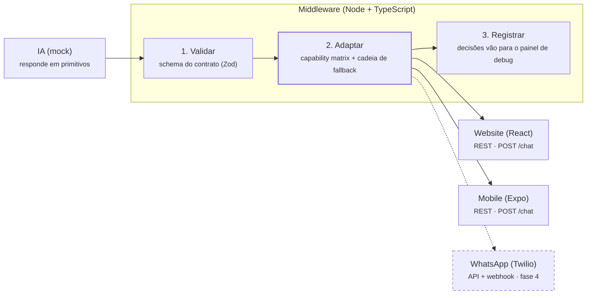
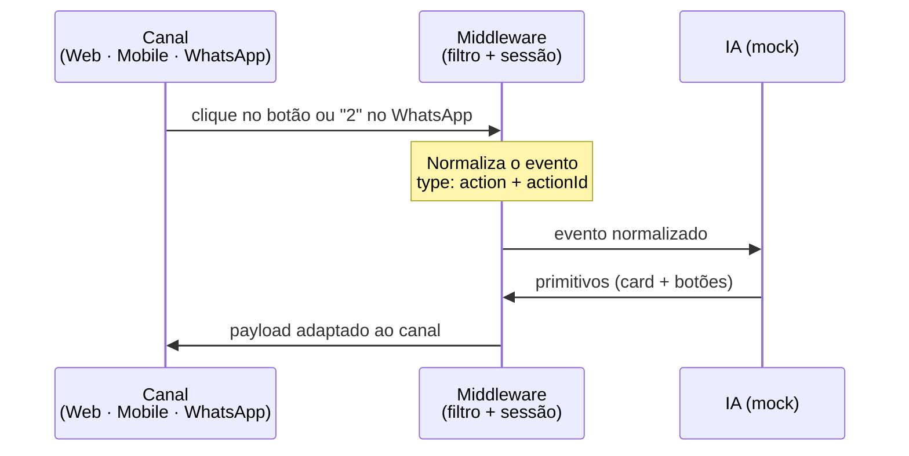

# Rosetta — POC de Tradução de Componentes

16/10/2026

## Por que essa POC existe

Queremos provar que uma IA consegue responder ao usuário uma única vez e essa resposta aparecer bem no site, no app e no WhatsApp, cada um do seu jeito.

Hoje a IA que ajuda o usuário a acumular pontos e trocá-los por passagens e produtos fala só com o app em React Native. Quando outros canais entrarem, o caminho óbvio seria ensinar a IA a montar uma resposta diferente para cada um. Isso não escala: cada canal novo vira mais uma regra dentro da IA.

A proposta é inverter isso. A IA passa a falar uma língua simples, feita de **componentes primitivos** (texto, imagem, botões, card, carrossel). Uma camada no meio traduz essa língua para o que cada canal sabe mostrar. Se o WhatsApp não tem carrossel, a camada transforma o carrossel em algo que ele tem, e nada se perde.

## Visão geral

A IA conversa só com o middleware, e o middleware conversa com os canais. Nenhum canal fala direto com a IA.



A resposta passa por três etapas: validação, adaptação (o coração da POC) e registro. Web e Mobile entram primeiro; o WhatsApp, tracejado, é a última etapa.

## A língua comum: componentes primitivos

A IA responde sempre com uma lista de componentes e nunca sabe para qual canal está falando. São cinco peças, escolhidas porque cobrem o roteiro de pontos e resgates:

| Componente | O que carrega | Exemplo no domínio |
| --- | --- | --- |
| `text` | Texto com markdown leve (negrito, itálico, listas) | "Você tem **12.400 pontos**" |
| `image` | URL + legenda opcional | Banner de campanha |
| `buttons` | Lista de ações `{ id, label }` | [Ver saldo] [Ver ofertas] |
| `card` | Imagem, título, subtítulo, preço em pontos, ações | Passagem São Paulo → Lisboa por 45.000 pts |
| `carousel` | Uma lista de `card` | Três ofertas lado a lado |

Uma resposta típica da IA:

```json
{
  "messages": [
    { "type": "text", "content": "Separei 3 ofertas para você:" },
    { "type": "carousel", "cards": [
      { "title": "São Paulo → Lisboa", "points": 45000,
        "image": "https://...", "actions": [{ "id": "offer_lis", "label": "Quero essa" }] }
    ]}
  ]
}
```

O contrato é versionado. Como os três projetos são independentes (cada um com suas dependências), ele mora no middleware e é copiado para os fronts por um script de sincronização.

## Como o filtro decide o que cada canal recebe

O filtro degrada, nunca descarta: se o canal não sabe mostrar um componente, ele cai para o próximo formato da cadeia até achar um que funcione.

Cada canal declara uma **capability matrix**, ou seja, o que sabe mostrar e com quais limites (quantos botões, tamanho do texto, se aceita carrossel). Cada componente tem uma **cadeia de fallback**. O filtro cruza as duas coisas.

| Componente | Web | Mobile | WhatsApp (Twilio) |
| --- | --- | --- | --- |
| `text` | Nativo, markdown renderizado | Nativo | Markdown convertido para `*negrito*` e `_itálico_` |
| `image` | Nativo | Nativo | Mensagem de mídia com legenda |
| `buttons` | Nativo | Nativo | Até 3 vira quick reply (rótulos com até 20 caracteres); acima de 3 vira lista; se nada servir, texto numerado ("responda 1, 2 ou 3") |
| `card` | Nativo | Nativo | Imagem + legenda + botões |
| `carousel` | Rolagem horizontal | Rolagem horizontal | Carrossel do Twilio quando disponível; senão, cards em sequência; em último caso, lista em texto |

Truncar rótulos e cortar listas longas também acontece aqui, porque faz parte de adaptar ao canal. Cada decisão tomada ("carrossel virou 3 cards") fica registrada para o painel de debug.

## Ida e volta: quando o usuário clica

A camada funciona nos dois sentidos. Um clique no app e um "2" digitado no WhatsApp chegam à IA como o mesmo evento.



No Web e no Mobile, o botão já manda o `actionId`. No WhatsApp, o middleware lembra quais opções mostrou naquela sessão e traduz o `ButtonPayload` ou o número digitado para o `actionId` certo. A IA nunca precisa saber de onde o clique veio.

## Como saberemos que deu certo

A POC está validada quando o mesmo roteiro roda do começo ao fim nos três canais e o painel de debug mostra a mesma resposta da IA virando três representações diferentes.

O roteiro é fixo e cobre todos os componentes:

1. O usuário diz "Oi" e recebe texto + botões [Ver saldo] [Ver ofertas].
2. Ver saldo: texto "Você tem 12.400 pontos" + imagem.
3. Ver ofertas: carrossel com 3 passagens ou produtos.
4. Escolhe uma oferta: card de confirmação + botões [Confirmar] [Cancelar].
5. Confirmar: texto de sucesso.

Como a IA é mockada, cada passo devolve sempre a mesma resposta. Assim qualquer diferença entre canais vem do filtro, que é exatamente o que queremos observar.

## Como o código se organiza

São três projetos independentes no mesmo repositório, todos em TypeScript:

| Pasta | Stack | Responsabilidade |
| --- | --- | --- |
| `middleware` | Node + Express | IA mockada, filtro, renderizadores por canal, painel de debug e, no fim, o webhook do Twilio |
| `web` | Vite + React | Chat que desenha os componentes no navegador |
| `mobile` | Expo + React Native | O mesmo chat no celular |

**Endpoints do middleware**

- `POST /chat` recebe `{ sessionId, channel, text | action }` e devolve `{ messages }` já adaptados para o canal.
- `GET /debug` mostra cada turno com a saída crua da IA, o resultado por canal e os fallbacks aplicados.
- `POST /twilio/webhook` recebe mensagens do WhatsApp (última etapa).

**Ordem de construção**

1. Middleware: contrato, IA mock, filtro e painel de debug.
2. Web: chat consumindo `POST /chat`.
3. Mobile: reaproveita a lógica do web.
4. WhatsApp via Twilio sandbox: adaptador, Content Templates para botões e webhook exposto com ngrok.

O Twilio fica por último de propósito. Ele depende de conta, sandbox e túnel, e até lá o filtro já vai estar provado em dois canais.

**Como rodar**

```bash
cd middleware && npm install && npm run dev   # http://localhost:3333, painel em /debug
cd web && npm install && npm run dev          # http://localhost:5173
cd mobile && npm install && npx expo start    # Expo Go, mesma rede
```

O passo a passo do sandbox do Twilio está em `middleware/README.md`. Sem credenciais, o webhook do WhatsApp roda em dry-run e os turnos aparecem no painel.

## Para onde isso pode ir: uma IA no lugar do middleware

Mais adiante, o middleware de regras pode dar lugar a uma IA dedicada à componentização, sem que os canais nem a IA de negócio percebam a troca.

Isso só é possível se a POC deixar duas fronteiras bem definidas:

- **Entrada:** a resposta da IA de negócio, no contrato de primitivos.
- **Saída:** o payload de cada canal, mais o registro de quais adaptações foram feitas.

Por isso o filtro será construído atrás de uma interface única, algo como `adapt(messages, channel) → { payload, decisions }`. A versão da POC implementa essa interface com regras. A versão futura implementa a mesma interface com uma IA, que pode tomar decisões mais ricas, como resumir um carrossel de 10 itens nos 3 mais relevantes para quem está no WhatsApp.

O motor de regras não é desperdiçado. Ele vira a rede de segurança: valida a saída da IA orquestradora e garante os limites duros de cada canal. Os logs do painel de debug viram material para avaliar se a IA decide melhor que as regras.

## Premissas, riscos e perguntas em aberto

**Premissas**

- A IA é mockada nesta fase; o foco é a camada de tradução, não a qualidade das respostas.
- Web e Mobile conversam com o middleware por REST (pergunta e resposta, sem streaming).
- Mesmo sem ter sido pedida, uma validação básica de schema (Zod) entra, porque o filtro precisa confiar no que recebe.

**Riscos**

- **Botões no WhatsApp:** no sandbox do Twilio, botões e listas dependem de Content Templates criados previamente. Se isso travar, o fallback em texto numerado garante que o roteiro continue.
- **Estado da sessão no WhatsApp:** quando o usuário responde "2", o middleware precisa lembrar quais opções mostrou. Na POC isso fica em memória.
- **Contrato copiado entre projetos:** com cópias separadas, os tipos podem divergir. O script de sincronização e o número de versão no contrato reduzem esse risco.

**Em aberto**

- [ ] Conta Twilio e sandbox: quem cria e quando?
- [ ] Os dados de exemplo (ofertas, preços em pontos, imagens) serão fictícios ou baseados no catálogo real?
- [ ] Quando a IA orquestradora entrar, ela usa o mesmo provedor de LLM da IA de negócio?
